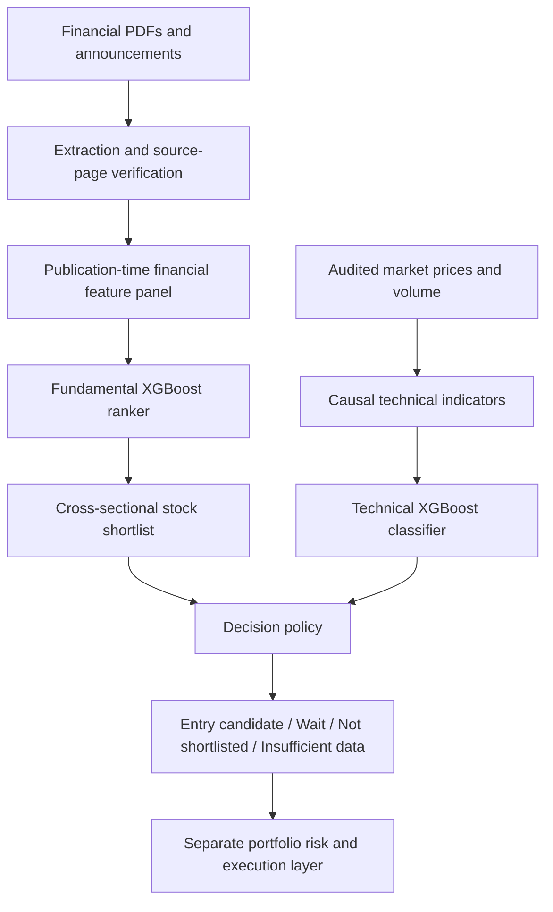

# Separate stock selection and entry timing

Fundamental analysis asks which businesses are attractive at their current valuation.
Technical analysis assesses whether current price/volume conditions offer a useful
entry opportunity. Neither guarantees a profitable purchase. This pipeline implements
two different supervised tasks, rather than two feature sets predicting the same label.



## Models and targets

| Component | Implemented model | Target | Primary metric | Output |
|---|---|---|---|---|
| Fundamental | XGBRanker, pairwise objective, grouped by market session | 126-session stock price return minus benchmark price return, converted to five relative relevance grades | NDCG within each date | Ranking score and universe-relative percentile |
| Technical | XGBClassifier, binary logistic objective | Next-session open to session t+10 close return, less declared round-trip costs, exceeds 2% | Average precision | Raw entry-outcome probability |
| Decision | Explicit conjunction, no learned blend | Top 20% fundamental percentile AND technical probability >= 0.60 | Requires separate joint strategy evaluation | ENTRY_CANDIDATE, WAIT, NOT_SHORTLISTED, INSUFFICIENT_DATA |

126 and 10 sessions, the 2% margin, 0.5% round-trip cost assumption, top fraction and
0.60 threshold are research defaults, not empirically optimized recommendations.
The classifier predicts a fixed-horizon outcome; it does not identify the optimal
intraday entry, guarantee a price, or model stop-loss/take-profit execution.
Raw probabilities are explicitly uncalibrated. A rank score is not a probability
or an intrinsic-value estimate. No generic 80–90% accuracy target applies to ranking.

Fundamental features reuse the existing 12 profitability, growth, valuation, leverage
and cash-flow fields. Technical features reuse the existing 20 price/volume indicators.
Neither model receives the other's features, predictions, or future target values.
Bank-specific financial comparability remains an upstream data/modeling consideration.
Repeated daily filing values are not independent new financial disclosures; future
experiments should compare monthly decision-date sampling using the same assessment.

## Input contract

The CLI reads three CSVs; the Python API accepts DataFrames. It does not automatically
turn the existing unadjusted v2 prices into audited adjusted prices, extract PDFs,
or claim that the repository's unresolved corporate actions have been resolved.

1. Panel: `symbol`, integer global `session`, timezone-aware `prediction_timestamp`
   and `available_from_timestamp`, plus every field in `m1.features.FUNDAMENTAL`
   and `m1.features.TECHNICAL`. One row per symbol/session. Features must use only
   data observable at that timestamp. Market-wide sessions must map to the same
   actual dates in all files. Predictions are made after the session close.
   Release timestamps must refer to the actual historical statement version.
   Missing fundamental values remain missing; no publication date is invented.
2. Prices: `symbol`, `session`, `adjusted_open`, `adjusted_close`, `price_valid`.
   Open and close must share a verified corporate-action adjustment basis.
   `price_valid` is an explicit upstream audit result, not a flag to blindly set true.
   This version measures price returns excluding dividends; do not mix total-return
   and price-return series. Audit evidence should be retained by the data producer.
3. Benchmark: `session`, `adjusted_close`, `price_valid`, on the same price-return
   basis, with one row for every session in the global market calendar.

Missing or invalid prices anywhere in a label window exclude that label. Missing
stock sessions are never compressed to create a false ten-session target. Fundamental
labels also require a valid benchmark window. Missing/stale filings do not prevent
independent technical training. At inference a missing model input or a single-stock
universe cannot produce a combined entry candidate. Supply the complete intended
eligible universe for meaningful cross-sectional ranks, not just a preselected ticker.

## Training and evaluation

`build_targets` constructs separate labels. `train_pipeline` uses explicit chronological
training, validation and test boundaries. Each branch purges by its own target end
session and adds a five-session embargo. It selects between depth 2 and depth 3 on
validation only, with 160 trees and fixed regularization, then evaluates the selected
model once on test. Training-frequency and constant-ranking baselines are included.
The saved model is not refitted on the test window. `predict_decisions` rejects dates
before the model-selection boundary. Missing features are handled natively by XGBoost.

This is an initial bounded search, not full Optuna optimization, nested walk-forward
validation, calibration, or a proven production strategy. Existing inspected dates
remain historical research data; the report always leaves fresh-holdout verification
false. Mean forward returns overlap and are not portfolio P&L. A next assessment
must add chronological outer folds, joint shortlist/entry evaluation, date-block
uncertainty, turnover, liquidity, portfolio constraints and realistic execution.
Evaluate any further tuning only inside the training-side folds.

Example from this directory (session boundaries are illustrative and must fit the
actual audited input history):

```powershell
python -m m1.decision_pipeline --panel data/decision_panel.csv --prices data/audited_prices.csv --benchmark data/audited_benchmark.csv --validation-start 500 --test-start 750 --output artifacts/selection_timing_v1
python -m pytest tests/test_decision_pipeline.py -q
```

The output directory must not already exist. Outputs are `decision_models.joblib`
and `evaluation.json`. Load only trusted local joblib artifacts. For inference use
`predict_decisions(joblib.load(path), current_panel)`. Configuration changes are
available through `DecisionConfig` in the Python API. Existing v1/v2/v3 artifacts,
APIs and live trading behavior are untouched. Tests use synthetic fixtures only;
they establish software behavior, not predictive performance on PSX data.
