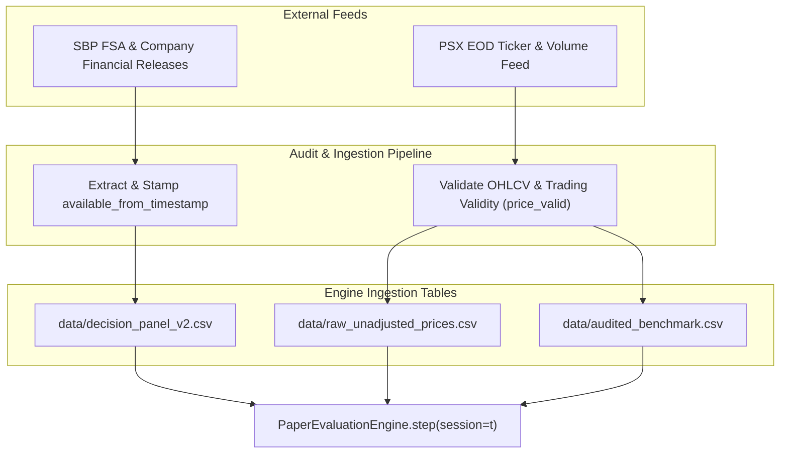

# Forward Paper Evaluation Operating Guide

This guide details how to operate, monitor, and audit the **Append-Only Forward Paper Evaluation Engine** for Module 1 of PSXpert.

The paper evaluation engine evaluates the decoupled fundamental selection and technical timing architecture forward in time without live market execution, lookahead bias, or data mutation.

---

## 1. Core Principles

1. **Frozen Models & Preprocessing**:
   All model binaries (`xgbranker`, `xgboost_classifier`), feature sets, and decision thresholds ($0.50$) are frozen and verified via SHA-256 checksums in `artifacts/frozen_research_release/release_manifest.json`. No retuning is performed during paper evaluation.

2. **Strict Chronological Sequence**:
   - **Session $t$ Close**: Generate fundamental scores and technical signals from information published by session $t$.
   - **Session $t$ Post-Close**: Generate and log intended buy orders (`intended_orders.csv`) with status `PENDING`.
   - **Session $t+1$ Open**: Execute pending buy orders at session $t+1$ Open, funded exclusively by session $t$ closing cash $C_t$.
   - **Session $t+10$ Close**: Execute scheduled position exits at session $t+10$ Close. Proceeds become available cash at session $t+11$ Open.
   - **Session $t+10$ Post-Close**: Record matured technical timing outcomes in `matured_technical_outcomes.csv`.
   - **Session $t+126$ Post-Close**: Record matured fundamental excess return outcomes in `matured_fundamental_outcomes.csv`.

3. **Append-Only Integrity**:
   Every log file is append-only. The engine checks that session $s > s_{\text{last}}$, preventing retroactive tampering or re-running past dates.

---

## 2. Directory & Log File Structure

All paper-trading outputs are maintained in the designated evaluation directory (e.g., `artifacts/paper_eval/` or test replays in `artifacts/paper_eval_replay_test/`):

| File Name | Description | Key Fields |
| :--- | :--- | :--- |
| `engine_state.json` | Persistent state snapshot between sessions | `last_processed_session`, `cash`, active `positions`, `next_order_id` |
| `signals_fundamental.csv` | Immutable fundamental rankings and shortlists | `timestamp_utc`, `session`, `symbol`, `fundamental_score`, `fundamental_rank_pct`, `is_shortlist` |
| `signals_technical.csv` | Immutable technical probabilities and signals | `timestamp_utc`, `session`, `symbol`, `technical_score`, `decision_threshold`, `entry_signal` |
| `intended_orders.csv` | Pre-execution buy orders logged before fills | `timestamp_utc`, `order_id`, `policy`, `symbol`, `side`, `status`, `requested_allocation_pkr` |
| `order_ledger.csv` | Executed order fills with explicit fees | `timestamp_utc`, `order_id`, `session`, `side`, `price`, `shares`, `gross_amount_pkr`, `fee_pkr`, `net_cash_flow_pkr` |
| `rejected_orders.csv` | Unfilled orders with explicit rationale | `timestamp_utc`, `order_id`, `symbol`, `reason` (e.g. `INSUFFICIENT_CASH`, `NO_OPEN_PRICE`) |
| `portfolio_daily_state.csv` | End-of-day equity, cash, and holdings | `session`, `policy`, `cash_pkr`, `positions_market_value_pkr`, `total_equity_pkr`, `active_positions_count`, `stale_positions_count` |
| `completed_trades.csv` | Round-trip completed trades with net PnL | `position_id`, `symbol`, `entry_session`, `exit_session`, `cost_basis_pkr`, `net_proceeds_pkr`, `net_pnl_pkr`, `net_return_pct` |
| `matured_technical_outcomes.csv` | Outcomes evaluated strictly after 10 sessions | `signal_session`, `maturity_session`, `symbol`, `technical_score`, `entry_signal`, `forward_return_10`, `benchmark_return_10`, `excess_return_10` |
| `matured_fundamental_outcomes.csv` | Outcomes evaluated strictly after 126 sessions | `signal_session`, `maturity_session`, `symbol`, `fundamental_score`, `rank_pct`, `forward_return_126`, `excess_return_126` |

---

## 3. Command-Line Interface (CLI)

The module `m1.paper_evaluation` provides three operating modes:

### A. Daily Step Evaluation (`step`)
Advances the paper evaluation by exactly one new trading session:
```bash
python -m m1.paper_evaluation step \
  --session 5926 \
  --eval-dir artifacts/paper_eval \
  --release-dir artifacts/frozen_research_release
```
- Checks that `5926 > last_processed_session`.
- Executes scheduled exits and pending morning buys.
- Generates point-in-time signals and intended orders.
- Writes state to disk.

### B. Controlled Replay Test (`replay`)
Runs a backtest replay over a historical session span into an isolated evaluation directory:
```bash
python -m m1.paper_evaluation replay \
  --start-session 5900 \
  --end-session 5925 \
  --eval-dir artifacts/paper_eval_replay_test \
  --release-dir artifacts/frozen_research_release
```
- Operates under identical forward constraints.
- Demonstrates append-only mechanics, order intent logging, fee accounting, and maturity delays.

### C. Status Inspection (`status`)
Prints current portfolio balances, active positions, cash holdings, and maturity metrics:
```bash
python -m m1.paper_evaluation status \
  --eval-dir artifacts/paper_eval
```

---

## 4. Operational Checklist for Daily Production

1. **Ingest Market Close Data**:
   Ensure daily OHLCV prices, volume, and financial statement releases are updated up to session $t$.
2. **Execute Single Step**:
   Run `python -m m1.paper_evaluation step --session <T>`.
3. **Review Output Logs**:
   - Inspect `intended_orders.csv` to observe tomorrow's morning candidate entries.
   - Inspect `rejected_orders.csv` for any unexpected liquidity or pricing issues.
   - Check `portfolio_daily_state.csv` to confirm equity balance matches $Cash + Market\_Value$.
4. **Periodic Milestone Reviews**:
   - **Quarterly (every 63 sessions)**: Review technical outcomes ($N \ge 60$) using Newey-West HAC tests.
   - **Annual (every 252 sessions)**: Review fundamental selection outcomes ($N \ge 252$) using NDCG@20%.

---

## 5. Market Data & Financial Statement Ingestion Architecture

Prospective evaluation relies on point-in-time data feeds updated strictly chronologically:



1. **Daily EOD Market Feed**:
   - Ingested at session close ($T$ 17:00 PKT).
   - Validates non-negative price, positive volume ($V_s > 0$), and corporate-action validity (`price_valid = True`).
   - Appended to `data/raw_unadjusted_prices.csv` and `data/audited_benchmark.csv`.
2. **Financial Statement Releases**:
   - Ingested upon formal public publication.
   - Explicitly records `available_from_timestamp` (must be prior to or equal to `prediction_timestamp`).
   - Gating check: `fundamental_eligible = has_financials & age_days.between(0, 550)`.
   - Stale or future-dated records are prevented from entering the ranking universe.

---

## 6. Training Target Alignment vs. Decision Probability Thresholds

To prevent methodological confusion between model training targets and decision thresholds:

| Concept | Formal Mathematical Definition | Role in System |
| :--- | :--- | :--- |
| **Fundamental Training Target** | $$r_t^{\text{fund}} = 100 \times \left(\frac{P_{t+126}^{\text{adjusted\_close}}}{P_t^{\text{adjusted\_close}}} - \frac{B_{t+126}^{\text{adjusted\_close}}}{B_t^{\text{adjusted\_close}}}\right)$$ | Ground truth target evaluated in `matured_fundamental_outcomes.csv` over contiguous 127-session valid window. |
| **Executable Fundamental Return** | $$r_t^{\text{exec}} = 100 \times \left(\frac{P_{t+126}^{\text{close}}}{P_{t+1}^{\text{open}}} - 1\right)$$ | Separately tracked metric reflecting achievable execution return. |
| **Technical Ground-Truth Target Label ($y$)** | $$y_t = \mathbb{I}\left(100 \times \left(\frac{P_{t+10}^{\text{close}}}{P_{t+1}^{\text{open}}} - 1\right) - 0.50\% > 2.0\%\right)$$ | Target classification label ($y \in \{0, 1\}$) defined by a **2.0% economic hurdle margin**. |
| **Model Output ($\hat{p}$)** | $$\hat{p}_t = P(y_t = 1 \mid \mathbf{x}_t) \in [0, 1]$$ | Posterior probability output by frozen XGBoost classifier. |
| **Decision Signal Threshold ($\tau$)** | $$\text{Entry Signal} = \mathbb{I}(\hat{p}_t \ge 0.50)$$ | Operational probability cutoff ($\tau = 0.50$) gating the trade. |

---

## 7. Risk Controls & Portfolio Drawdown Circuit Breaker

1. **Declared Limit**:
   - Maximum Drawdown Limit: **25.0%**.
   - Formula: $DD_s = \frac{\text{Peak Equity} - \text{Total Equity}_s}{\text{Peak Equity}}$.
2. **Circuit Breaker Behavior**:
   - When $DD_s \ge 25.0\%$, `circuit_breaker[policy]["active"]` is set to `True`.
   - **Halts New Entries**: All pending buy orders are rejected with reason `CIRCUIT_BREAKER_HALT`.
   - **Orderly Exits**: Active positions continue to run to their scheduled $T+10$ exit (or delayed exit).
   - **Persistent**: Halt state is written to `engine_state.json` and persists across restarts.
3. **Administrative Resume Procedure**:
   - The engine will not resume buying until explicitly reset with a formal audit rationale:
     ```bash
     python -m m1.paper_evaluation resume-circuit-breaker \
       --policy Policy_A \
       --rationale "Formal audit completed by risk committee; regime normalized." \
       --eval-dir artifacts/paper_eval
     ```

---

## 8. Acceptance Verification Checklist

| Guarantee | Executable Behavior | Automated Passing Test | Status |
| :--- | :--- | :--- | :---: |
| **Outcome Target Matching** | 126-session close-to-close excess return matching training target; separate executable metric | `test_synthetic_128_session_fixture_both_horizons_exercised` in `test_paper_evaluation_acceptance.py` | **VERIFIED** |
| **Crash Safety & Idempotency** | Auto-rollback of uncommitted session writes; primary-key deduplication | `test_crash_safety_rollback_and_idempotency` in `test_paper_evaluation_acceptance.py` | **VERIFIED** |
| **Session Continuity** | Rejects skipped session gaps; enforces contiguous progression | `test_session_continuity_enforcement` in `test_paper_evaluation_acceptance.py` | **VERIFIED** |
| **Unresolved Outcomes Queue**| Tracks suspended/halted securities across sessions rather than dropping | `test_unresolved_matured_outcomes_queue` in `test_paper_evaluation_acceptance.py` | **VERIFIED** |
| **Frozen Release Integrity** | Validates SHA-256 release manifest hashes before execution | `test_frozen_release_contract_enforcement` in `test_paper_evaluation_acceptance.py` | **VERIFIED** |
| **Config Immutability** | Rejects parameter alterations on resumed evaluation | `test_configuration_immutability_on_resume` in `test_paper_evaluation_acceptance.py` | **VERIFIED** |
| **Drawdown Circuit Breaker** | 25% drawdown halt, persists across restarts, explicit resume command | `test_drawdown_circuit_breaker_and_administrative_resume` in `test_paper_evaluation_acceptance.py` | **VERIFIED** |
| **Prospective Isolation** | Prevents replay writes to `artifacts/paper_eval`; tags provenance metadata | `test_frozen_release_contract_enforcement` & directory safety checks | **VERIFIED** |

