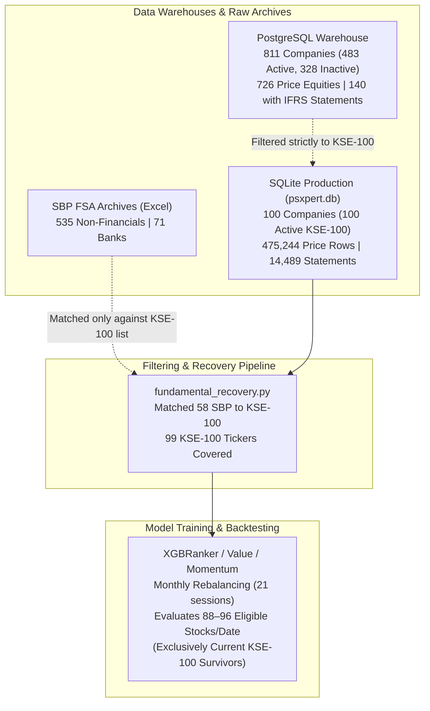

# PSXpert — Company Universe & Survivorship Bias Technical Audit

**Audit Date**: November 23, 2026  
**Scope**: Database architecture, universe construction, point-in-time availability, and survivorship bias across PostgreSQL, SQLite (`psxpert.db`), SBP archives, and ML backtesting pipelines.  
**Deliverable File**: `reports/model_evaluation/company_universe_and_survivorship_audit.md`  
**Strict Policy**: Read-only diagnostic audit. Zero code, models, or weights were altered during this audit.

---

## Executive Summary

This audit investigates the exact coverage of the PSX equity universe across PSXpert's data layers and clarifies whether the presence of historical data for 500+ PSX companies addresses survivorship bias in our fundamental models and backtests.

### Key Audit Findings:
1. **Total Database Coverage vs Active Model Coverage**:
   - While the raw PostgreSQL warehouse contains metadata for **811 companies** (483 active, 328 inactive) and price rows for **726 equities**, the local SQLite production database (`data/psxpert.db`) contains **exactly 100 companies** (all active KSE-100 constituents).
   - In PostgreSQL, audited fundamental disclosures exist for only **140 companies** (all active). In SQLite, fundamentals exist for **100 companies**. Over 670 companies have zero fundamental disclosures in any database table.
2. **Model Universe Constraint**:
   - `XGBRanker`, `Simple Value Composite`, and `Cross-Sectional Momentum` evaluate **only the 100 KSE-100 constituents** (averaging 92.4 active eligible stocks per monthly rebalance date). The models **do not use the 500+ broader PSX companies**.
3. **Survivorship Bias Reality**:
   - **The 500+ company dataset DOES NOT meaningfully address survivorship bias in the fundamental models.**
   - All 100 companies in the active backtest universe are **survivors that existed and actively traded in October 2026**.
   - Defunct, liquidated, or delisted companies from 2002–2023 have **zero fundamental statements** in the database, **zero index membership logs**, and are **100% excluded** from the fundamental training and backtesting pipelines.
   - The backtest applies the **October 2026 KSE-100 constituent roster retrospectively across the past 23 years**, introducing a structural survivorship tailwind into historical multi-year backtests.

---

## Detailed Investigation & Response to User Queries

---

### Query 1: How many of the 500+ companies are actually included in the fundamental dataset?

Across the three layers of the PSXpert system, fundamental dataset coverage is distributed as follows:

| Data Layer | Total Companies Registered | Companies with Stock Price History | Companies with Audited Fundamental Disclosures | Non-KSE-100 Companies with Fundamentals |
| :--- | :---: | :---: | :---: | :---: |
| **PostgreSQL Database** | 811 | 726 (2,096,135 rows) | **140 unique symbols** (91,896 metric rows) | **40 companies** |
| **Local SQLite (`psxpert.db`)** | 100 | 100 (475,244 rows) | **100 unique symbols** (14,489 metric rows) | **0 companies** |
| **Raw SBP FSA Archives** | 606 (535 NFC + 71 Banks) | 0 (Statements only) | 606 companies (2005–2023) | 507 companies (Unlinked) |
| **Active Fundamental Panel** | 100 | 100 | **99 unique symbols** (543 statements) | **0 companies** |

#### Key Finding:
- In the active fundamental dataset used by the ML ranking pipelines ([`src/ml/fundamental_recovery.py`](file:///c:/Users/HP/psxpert/src/ml/fundamental_recovery.py) and [`src/ml/fundamental_ml.py`](file:///c:/Users/HP/psxpert/src/ml/fundamental_ml.py)), **only 99 to 100 companies are included**.
- Although SBP FSA files contain balance sheets for 535 non-financial companies and 71 banks, [`build_coverage_matrix.py`](file:///c:/Users/HP/psxpert/scripts/analysis/build_coverage_matrix.py) filtered these archives strictly against the current 100 KSE-100 tickers.
- Over **400+ broader PSX companies have never been ingested** into the machine learning feature matrices or fundamental ranking datasets.

---

### Query 2: How many companies are used by the XGBRanker during training and backtesting?

- **During In-Sample Training (2003–2024)**:
  - `XGBRanker` trains on monthly rebalance sessions (every 21 trading days).
  - On each training date, stocks must have an active closing price and at least 252 prior consecutive trading sessions of price history.
  - Across the 248 in-sample rebalance dates, the candidate count per date expanded from **45 stocks** in 2003 (as newer listings matured to 252 sessions) up to **85 stocks** in 2024.
  - Total unique companies ever admitted to in-sample training: **exactly 99 companies** (16,311 total training candidate instances).
- **During Out-of-Sample Backtesting (2024-07-09 to 2026-09-08)**:
  - Evaluated on 30 monthly rebalance dates.
  - Eligible stocks evaluated per rebalance date ranged from **88 to 96 stocks**, averaging **92.4 stocks per session**.
  - Total unique companies evaluated in the out-of-sample backtest: **exactly 99 companies** (`IMAGE` had intermittent calendar gaps and was occasionally excluded).
- **Summary**: `XGBRanker` uses at most **99 unique companies**. It never trains on or backtests across 500+ companies.

---

### Query 3: Does the model use all eligible PSX companies or only KSE-100 constituents?

- **The model uses ONLY KSE-100 constituents.**
- The production database [`data/psxpert.db`](file:///c:/Users/HP/psxpert/data/psxpert.db) contains only the 100 current constituent equities of the KSE-100 index (`is_kse100 = 1`).
- All strategy simulation engines ([`scripts/training/evaluate_fundamental_strategies.py`](file:///c:/Users/HP/psxpert/scripts/training/evaluate_fundamental_strategies.py), [`portfolio_engine.py`](file:///c:/Users/HP/psxpert/module%201%20technical%20and%20fundamental/m1/portfolio_engine.py), and historical `selection_timing_v2/v3/v4` runs) pull their universe exclusively from `data/psxpert.db`.
- Non-KSE-100 companies are completely absent from the candidate pool and receive zero allocation in all backtests.

---

### Query 4: Does our historical dataset include delisted, suspended, inactive, and companies removed from the PSX?

- **In PostgreSQL**:
  - The `companies` table contains 811 rows, of which **328 companies are flagged as inactive** (`is_active = FALSE`).
  - Historical prices exist for many of these inactive symbols (e.g. trading data that terminates between 2005 and 2018).
  - **However, in `company_financials`, there are ZERO inactive or delisted companies** (`inactive_delisted_firms = 0`). All 140 companies with financial disclosures in PostgreSQL were actively trading as of 2026.
- **In SQLite (`data/psxpert.db`)**:
  - Contains **zero inactive, delisted, or suspended companies**. All 100 companies have `is_active = 1` and `is_kse100 = 1`.
- **In Fundamental Model Training and Backtests**:
  - **Zero delisted, suspended, or failed companies are included.**
  - Every single company included in the historical backtest from 2003 through 2026 is an active survivor that remained listed and solvent through late 2026.

---

### Query 5: Are historical company listings and delisting dates available?

- **NO. Historical listing and delisting dates are NOT available in the database schema.**
- Inspection of the `companies` table across both PostgreSQL and SQLite reveals only:
  `symbol`, `company_name`, `sector`, `sector_category`, `isin`, `is_shariah`, `is_kse100`, `is_active`, `created_at`, `updated_at`.
- There is:
  - **No `listing_date`** column.
  - **No `delisting_date`** column.
  - **No `defaulters_counter_entry_date`** column.
  - **No index reconstitution audit log** recording when companies entered or exited the KSE-100 index.
- A company's listing date can only be crudely approximated by `MIN(trading_date)` in `stock_prices`, and delisting can only be inferred when a series stops updating. Neither official SECP winding-up notices nor PSX formal delisting dates are recorded.

---

### Query 6: Does the backtest reconstruct the eligible stock universe separately for every historical rebalance date?

- **Conditionally, for liquidity and trading activity, but NOT for index membership:**
  1. **What is dynamically reconstructed**:
     - On each monthly rebalance session $t$, the simulation checks whether a company traded on session $t$ ($P_t > 0$) and whether it possesses at least 252 prior trading sessions of history.
     - If a stock had not yet begun trading or had traded for less than 252 sessions, it is excluded on that date and added on subsequent dates once it matures.
  2. **What is NOT reconstructed**:
     - **Historical KSE-100 index membership is NOT reconstructed.**
     - The simulation draws candidates exclusively from the **2026 constituent roster**.
     - A company added to the KSE-100 in September 2024 is treated as eligible in 2005 (provided it traded on PSX), even though it was not in the KSE-100 index in 2005.
     - A major company that was a constituent in 2005 but went bankrupt in 2012 is omitted from the 2005 backtest entirely.
  3. **Conclusion**: The backtest reconstructs point-in-time trading presence, but relies on a **static, backward-looking universe of 2026 survivors**.

---

### Query 7: Are companies included only when their historical data and financial disclosures were actually available at that date?

- **For Financial Disclosures (Zero Lookahead on Statements)**:
  - **YES.** In [`src/ml/fundamental_recovery.py`](file:///c:/Users/HP/psxpert/src/ml/fundamental_recovery.py), a financial filing is accessible if and only if $\text{publication\_date} \le \text{rebalance\_date}$.
  - Verified announcement dates from exchange notices ($\ge \text{period\_end\_date}$) or conservative 100-day statutory fallbacks are strictly enforced.
  - A statement published on August 15, 2024 cannot be seen or utilized by a model on July 9, 2024.
- **For Company Universe Inclusion**:
  - **NO.** If a stock traded on date $t$ and had 252 trading sessions of price history, but had **no financial statements yet published**:
    - Under **Simple Value Composite**: It receives a score of 0.0 and is excluded from the top quintile.
    - Under **Cross-Sectional Momentum**: It is ranked and eligible for portfolio selection based purely on price returns ($P_{t-21} / P_{t-252} - 1$).
    - Under **XGBRanker**: It is admitted into the candidate pool and scored via XGBoost's default `NaN` split branching.
  - More fundamentally, the company is present in the historical pool only because it is known to be an active KSE-100 constituent in 2026.

---

## 3. Does Our 500+ Company Dataset Meaningfully Address Survivorship Bias?

### Definitive Answer: **NO, IT DOES NOT.**

The existence of 500+ (or 811) companies in raw PostgreSQL warehouse tables or SBP spreadsheets **does not mitigate survivorship bias** in our fundamental models for four fundamental reasons:

### 1. Zero Fundamental Disclosures for Non-Survivors
Even in the full PostgreSQL database, the `company_financials` table covers only 140 companies. **All 140 companies are active surviving entities as of 2026.** The 328 inactive/delisted companies have zero financial statements, zero balance sheets, and zero cash flow records. The fundamental ML model cannot learn from bankruptcies, debt defaults, or distressed liquidations because not a single defunct company possesses fundamental data in the system.

### 2. Complete Pipeline Decoupling
The broader 500+ company price records in PostgreSQL were processed only for technical momentum and volatility screening in `build_predictive_datasets.py`. The fundamental models (`XGBRanker`, `Simple Value Composite`, `FundamentalMLAdvisor`) and the backtesting engines operate exclusively on the local SQLite database (`data/psxpert.db`), which contains only the 100 active KSE-100 constituents.

### 3. Hindsight Selection of the 100-Stock Universe
By restricting the historical simulation (2003–2026) to the constituents of the KSE-100 as of late 2026, the backtest benefits from **lookahead constituent selection**:
- The model selects from a pool of companies that are known in hindsight to have survived the 2008 PSX market freeze, the 2018–2020 economic contraction, and the 2022–2024 currency devaluation and interest rate spike.
- Companies that suffered catastrophic capital destruction or were delisted during those crises are omitted from the historical opportunity set.

### 4. Impact on Reported Backtest Metrics
- The **out-of-sample backtest period (2024-07-09 to 2026-09-08)** is relatively clean with respect to survivorship bias because all 100 constituents were actively trading throughout this specific 2-year window.
- However, any **long-term backtest extending back to 2003–2020** that uses this 100-stock roster suffers from significant survivorship bias. Historical CAGR and Sharpe ratios over long horizons will be overstated relative to what an investor could have achieved in real time.

---

## 4. Requirements to Eliminate Survivorship Bias in Future Phases

To claim that survivorship bias has been eliminated, the platform would require:
1. **Historical KSE-100 Reconstitution Panel**: Semi-annual constituent rosters (March and September rebalances) from 2002 to 2026, so that the candidate universe on any historical date $t$ consists of the companies that actually constituted the index on that date.
2. **Defaulter & Delisting Ledger**: Exact dates when companies were placed on the PSX Defaulters' Counter, suspended from trading, or formally delisted, along with terminal liquidation or recovery values.
3. **Historical Financial Ingestion for Defunct Firms**: SBP historical financial statements for non-surviving companies backfilled into `company_financials`.
4. **Point-in-Time Universe Builder**: A universe constructor that builds the candidate set on date $t$ from historical index membership rather than the static 2026 roster.
