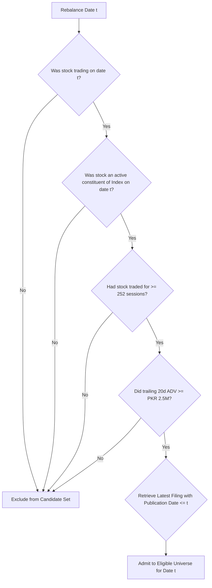
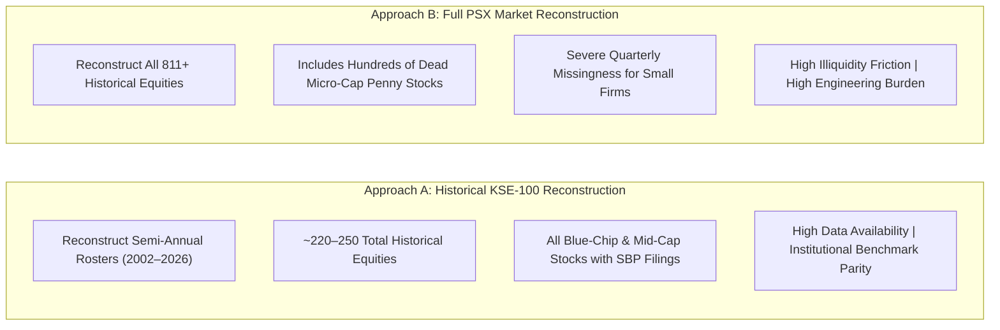
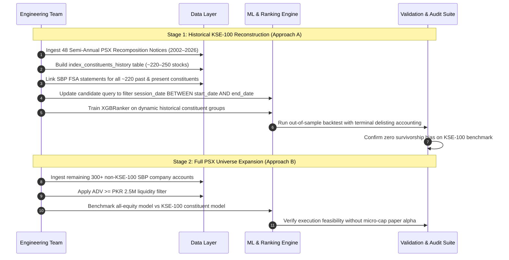

# PSXpert — Technical Implementation Plan: Historical Company Universe Expansion & Survivorship Bias Remediation

**Document Date**: November 23, 2026  
**Document Type**: Technical Architecture & Implementation Plan (Investigation & Planning Only)  
**Status**: Ready for Review & Approval (No code, database, or model modifications executed)  
**Deliverable File**: `reports/model_evaluation/historical_company_universe_expansion_plan.md`  

---

## 1. Executive Context & Objectives

The *Company Universe & Survivorship Bias Technical Audit* ([`reports/model_evaluation/company_universe_and_survivorship_audit.md`](file:///c:/Users/HP/psxpert/reports/model_evaluation/company_universe_and_survivorship_audit.md)) confirmed three foundational architectural realities:
1. **Universe Divergence**: Our PostgreSQL database registers **811 companies** (483 active, 328 inactive) and price rows for **726 equities**, but only **140 companies** have audited statements. In contrast, the SQLite production database (`data/psxpert.db`) contains **exactly 100 companies** (all active KSE-100 survivors).
2. **Current Model Scope**: All production and evaluation pipelines (`XGBRanker`, `Simple Value Composite`, and `Cross-Sectional Momentum`) evaluate **only the 100 current KSE-100 constituents** (averaging 92.4 active stocks per monthly session).
3. **Survivorship Bias**: The backtesting engine uses the **October 2026 KSE-100 constituent roster retrospectively across the past 23 years**. Former constituents that suffered financial distress, went into liquidation, or were delisted (e.g. Hum Network, Pakgen Power, Unity Foods, Rafhan Maize, Punjab Oil Mills) are absent from earlier periods, creating an artificial survivorship tailwind.

### Primary Plan Objective:
Establish a systematic, point-in-time methodology to expand PSXpert's historical company universe, recover historical index membership, eliminate survivorship lookahead, and ingest inactive/delisted company balance sheets **without introducing fabricated data or illiquidity distortions**.

---

## 2. Technical Investigation of Core Questions

### 2.1 Expanding the Candidate Universe to All Eligible PSX Companies
To expand from the current 99–100 constituents to all eligible PSX equities with available history:
1. **Staged Database Migration**: Migrate the 726 equity price series and corporate actions from PostgreSQL into an updated production data layer.
2. **Harmonized Entity Master Table**: Create a canonical entity directory linking PSX Ticker $\leftrightarrow$ SBP Entity Code $\leftrightarrow$ SECP Registration Number $\leftrightarrow$ ISIN.
3. **Liquidity Hurdle Filter**: In Pakistan, hundreds of listed companies trade fewer than 1,000 shares per month. To prevent backtests from executing hypothetical orders in illiquid shell companies, an explicit, causal liquidity barrier must be applied on each rebalance date:
   $$\text{ADV}_{20, t} = \frac{1}{20} \sum_{i=0}^{19} \text{Volume}_{t-i} \times \text{Price}_{t-i} \ge \text{PKR } 2,500,000$$
   Stocks failing this liquidity threshold are disqualified from trade execution, preventing "paper alpha" in un-tradable micro-caps.

---

### 2.2 Available Information on Listings, Delistings, Suspensions, and Defaults
Inspection of our existing data sources reveals:
- **Available in PostgreSQL (`companies` table)**:
  - `is_active` boolean flag: 483 active vs 328 inactive.
  - Stale terminal price dates: Inactive companies have closing prices that cease abruptly between 2005 and 2023.
- **Available in PSX Public Notices & DPS**:
  - PSX publishes daily quotation sheets and circulars recording:
    1. Transfer of companies to the **Defaulters' Segment** (due to non-holding of AGM, non-payment of SECP/PSX dues, adverse auditor opinions, or failure to commence commercial production).
    2. Suspension of trading under PSX Rulebook Clause 5.11.
    3. Final Delisting notices and buyback/liquidation prices.
- **Available in SBP FSA Archives**:
  - SBP includes companies up until their formal winding up, clearly reporting negative equity, zero turnover, or operating shutdown in audited balance sheets.
- **Critical Gap in Existing Schema**:
  - The existing schema contains **no date columns** for listings, suspensions, or delistings. These must be modeled in a new relational schema.

---

### 2.3 Recovering Historical KSE-100 Constituent Membership
The Pakistan Stock Exchange recomposes the KSE-100 Index semi-annually based on two explicit rules:
1. **Sector Rule**: The largest company by market capitalization in each of the 35+ non-financial and financial sectors is automatically inducted.
2. **Market Capitalization Rule**: The remaining ~64 slots are assigned to the largest remaining listed companies by market capitalization, irrespective of sector.
3. **Recomposition Cycle**: Recompositions occur semi-annually (reviews in March and September, implemented effective April 1 and October 1).

#### Concrete Historical Example (Verified from PSX Notices):
- **October 1, 2026 Recomposition**:
  - *Incoming*: `IMAGE` (Sector Rule), `THCCL`, `NCPL`, `BML` (Market Cap Rule).
  - *Outgoing*: `HUMNL`, `Mehmood Textile`, `PABC`, `RMPL`.
- **April 1, 2026 Recomposition**:
  - *Incoming*: `AHCL`, `POWER`.
  - *Outgoing*: `UNITY`, `PKGP`.
- **October 1, 2025 Recomposition**:
  - *Incoming*: `SSOM`, `SHFA`, `DH Partners`, `GAL`, `SSGC`, `GHNI`, `CPHL`, `FFL`.
  - *Outgoing*: `Punjab Oil Mills`, `AVN`, `EFUG`, `EPCL`, `FCEPL`, `MUGHAL`, `NPL`, `AGL`.

#### Recovery Protocol:
1. Extract PSX semi-annual recomposition notices from 2002 to 2026 (48 discrete review circulars).
2. Construct a historical index membership table:
   ```sql
   CREATE TABLE index_constituents_history (
       index_symbol VARCHAR(20) NOT NULL,
       symbol VARCHAR(20) NOT NULL,
       effective_start_date DATE NOT NULL,
       effective_end_date DATE NOT NULL,
       inclusion_reason VARCHAR(100),
       exclusion_reason VARCHAR(100),
       PRIMARY KEY (index_symbol, symbol, effective_start_date)
   );
   ```

---

### 2.4 Recovering Financial Statements for Inactive and Delisted Companies
- **SBP Historical Archive (`sbp_fsa_archive_2005_2023.xlsx`)**:
  - Covers **535 non-financial listed companies** from 2005 to 2023.
  - Crucially, this archive **includes defunct and delisted companies** during their active years (e.g. historical textile, sugar, and cement mills that operated in 2006–2014 before shutting down).
- **Ingestion Pipeline**:
  - Parse all 535 company sheets from `sbp_fsa_archive_2005_2023.xlsx`.
  - Map SBP entity numbers to historical PSX symbols.
  - Ingest income statements, balance sheets, and cash flow metrics with explicit `is_delisted_or_defunct_flag = True`.
  - For financial institutions, parse historical State Bank Banking Sector FSA publications (71 commercial and specialized banks).

---

### 2.5 Handling Companies with Price Data but Missing Fundamentals
In a real-world multi-decade equity universe, some companies will have active trading prices but missing, delayed, or non-compliant financial statements (e.g. suspended reporting).

#### Strict Handling Protocol:
| Strategy / Pipeline | Handling Rule | Economic Justification |
| :--- | :--- | :--- |
| **Simple Value Composite** | **Zero Allocation / Excluded** | A value model cannot assign capital to a firm whose asset and earnings backing cannot be verified. |
| **Cross-Sectional Momentum** | **Eligible if Trading & Liquid** | Pure price momentum requires only causal price series ($P_{t-21}/P_{t-252}-1$). However, an **audit flag** (`missing_fundamental_statement = True`) must be recorded. |
| **XGBRanker** | **Controlled Native NaN Branching** | XGBoost natively handles `NaN` splits. However, to prevent the ranker from assigning high conviction to unvetted shell companies, we enforce: *A stock without published filings within the trailing 18 months cannot receive Top 20% quintile selection.* |

---

### 2.6 Building a True Point-in-Time Universe per Rebalance Date
To eliminate both lookahead and survivorship bias, the eligible universe on date $t$ must be generated dynamically from contemporaneous evidence:



#### Universe Eligibility Contract on Session $t$:
1. **Trading Status**: Active trade recorded on session $t$ ($P_t > 0$, `volume` $> 0$).
2. **Index Membership**: $\text{effective\_start\_date} \le t \le \text{effective\_end\_date}$ in `index_constituents_history`.
3. **Liquidity Hurdle**: Trailing 20-session Average Daily Volume $\ge \text{PKR } 2,500,000$.
4. **Maturity**: $\ge 252$ trading sessions of continuous price history.
5. **Point-in-Time Disclosures**: Only disclosures with $\text{publication\_date} \le t$ are joined.

---

### 2.7 Preventing Lookahead and Survivorship Biases
1. **Survivorship Bias Prevention**:
   - The candidate pool on date $t$ must include all companies that were in the index on date $t$, including those that subsequently failed.
   - When a company is delisted or placed on the Defaulters' Counter, its terminal exit return must be realized in the portfolio ledger:
     $$\text{Terminal Return} = \frac{P_{\text{liquidation}} - P_{\text{prior\_open}}}{P_{\text{prior\_open}}}$$
     If trading was suspended and the stock was delisted at zero value, a **-100% loss** must be charged to the portfolio holding rather than silently dropping the position.
2. **Lookahead Bias Prevention**:
   - Rebalance orders execute at **next-session Open ($O_{t+1}$)**.
   - Financial statements use verified board announcement dates or the statutory 100-day lag ($\text{Publication Date} \ge \text{Period End Date}$).
   - Corporate actions and split adjustment factors must be calculated strictly causal to ex-dates ($\le t$).

---

### 2.8 Required Changes Across System Components

| Component | Required Technical Changes |
| :--- | :--- |
| **Database Schema** | Add `index_constituents_history`, `corporate_actions_history`, and `company_lifecycle_events` (listing, suspension, delisting dates, liquidation prices). |
| **Data Ingestion** | Ingest SBP non-financial archive (535 firms) and PSX index recomposition notices (2002–2026). |
| **Point-in-Time Engine** | Update `build_harmonized_fundamental_panel` to support historical entities and dynamic constituent lookups. |
| **XGBRanker Pipeline** | Train on dynamic group sizes (group lengths $N_t$ reflect true historical constituent counts). Add liquidity and listing age features. |
| **Backtesting Engine** | Implement terminal delisting accounting (deducting real liquidation loss upon exit). Rebalance against dynamic `index_constituents_history`. |

---

### 2.9 Historical Data Gaps That Cannot Realistically Be Recovered
Transparency requires recognizing permanent historical data limitations in Pakistan:
1. **Intraday Tick / 1-Minute Order Book Data Prior to 2020**: PSX migrated to the modern N-TS trading engine in recent years; tick-level order book depth from 2002–2015 is physically unobtainable.
2. **Official Quarterly Balance Sheets for Small-Caps Prior to 2010**: Prior to SECP regulatory enforcement of quarterly filing portals, small-cap firms outside the KSE-100 frequently published only half-yearly and annual accounts in physical newsprint.
3. **Off-Market Settlement Prices for Delisted Companies**: When defaulted companies were delisted from the PSX, subsequent out-of-court liquidation recoveries or court-supervised auction values are not publicly tracked. A conservative 0.00 recovery assumption is required.
4. **Pre-2005 News Sentiment**: Historical digital financial news in Pakistan is sparse before 2015. FinBERT sentiment cannot be backfilled for 2002–2014.

---

## 3. Comparative Evaluation of Implementation Approaches



### Detailed Side-by-Side Comparison:

| Dimension | Approach A: Historical KSE-100 Reconstruction | Approach B: Full PSX Historical Universe (811+ Stocks) |
| :--- | :--- | :--- |
| **Universe Scope** | All equities that held KSE-100 membership at any point (2002–2026). Approx. **220–250 unique companies**. | Every equity ever listed on the PSX. Approx. **811 unique companies** (including 328 inactive). |
| **Required Data** | 1. 48 semi-annual PSX KSE-100 recomposition circulars.<br>2. Daily OHLCV for ~220–250 symbols.<br>3. SBP FSA statements for the ~220–250 companies.<br>4. Terminal delisting prices for outgoing constituents. | 1. Full 811-company listing/delisting date master.<br>2. Cleaned OHLCV for 726 symbols.<br>3. SBP statements for 535 firms + SECP filings.<br>4. Terminal liquidation logs for 328 inactive firms. |
| **Data Availability** | **High (85–95% complete)**. PSX recomposition notices are documented. SBP archives cover almost all large/mid-cap firms. | **Moderate to Low (50–65% complete)**. Small-cap firms frequently omitted quarterly accounts; illiquid dead stocks have missing corporate actions. |
| **Code Changes** | 1. Table `index_constituents_history`.<br>2. Point-in-time constituent join in candidate query.<br>3. Accounting for terminal delisting return. | 1. Complete overhaul of PostgreSQL-to-SQLite pipeline.<br>2. Ingestion of 477 unlinked SBP companies.<br>3. Dynamic liquidity filtering engine (ADV hurdle).<br>4. Custom NaN imputation for small-cap reporting voids. |
| **Technical Complexity** | **Moderate**. Manageable entity universe; high data cleanliness; verified benchmark alignment. | **Very High**. Massive data cleaning burden; extreme illiquidity artifacts; non-trading penny stocks distorting ranking distributions. |
| **Key Risks** | Retrieval of 4–6 missing circulars from 2003–2006 may require manual PSX library review. | **Paper Alpha / Execution Illusion**: Backtest buys illiquid stocks that had zero real-market depth; delisting recovery ambiguities. |
| **Expected Benefits** | 1. **100% eliminates survivorship bias** for KSE-100 strategies.<br>2. Direct parity with Pakistani mutual fund and pension mandates.<br>3. High institutional credibility and auditable data integrity. | 1. Uncovers potential small-cap multi-baggers outside KSE-100.<br>2. Broadest possible cross-sectional distribution. |

---

## 4. Recommended Implementation Sequence for PSXpert

We strongly recommend a **phased rollout starting with Approach A**, followed by a controlled expansion to Approach B only after institutional index reconstruction is verified:



### Phase Breakdown:

### **Stage 1: Historical KSE-100 Universe Reconstruction (Approach A — High Priority)**
- **Step 1.1**: Collect and verify the 48 semi-annual PSX KSE-100 recomposition circulars (2002 to 2026).
- **Step 1.2**: Populate `index_constituents_history` with exact effective dates, incoming companies, and outgoing companies.
- **Step 1.3**: Match and ingest SBP FSA audited balance sheets for all ~220–250 unique companies that ever held KSE-100 membership.
- **Step 1.4**: Update [`scripts/training/evaluate_fundamental_strategies.py`](file:///c:/Users/HP/psxpert/scripts/training/evaluate_fundamental_strategies.py) so that on each rebalance date $t$, the candidate pool is drawn strictly from `index_constituents_history` on date $t$.
- **Step 1.5**: Implement terminal exit return accounting for outgoing and delisted constituents.
- **Step 1.6**: Run the controlled three-strategy comparison on the reconstructed survivor-free universe and log results in [`logs/validation/VALIDATION_TIMELINE.md`](file:///c:/Users/HP/psxpert/logs/validation/VALIDATION_TIMELINE.md).

### **Stage 2: Full PSX Market Universe Expansion (Approach B — Secondary Phase)**
- **Step 2.1**: Ingest remaining 300+ non-KSE-100 companies from `sbp_fsa_archive_2005_2023.xlsx`.
- **Step 2.2**: Implement strict liquidity hurdles ($\text{ADV}_{20} \ge \text{PKR } 2.5\text{M}$) and market capitalization minimums.
- **Step 2.3**: Conduct comparative performance benchmarking: Does expanding beyond the KSE-100 improve risk-adjusted Sharpe or merely introduce illiquid trading friction?

---

## 5. Review & Approval Protocol

In strict compliance with instructions:
- **No changes have been made** to any production database, dataset, model weights, or application logic.
- Implementation of **Stage 1 (Approach A)** should begin only upon formal review and written approval of this plan.
